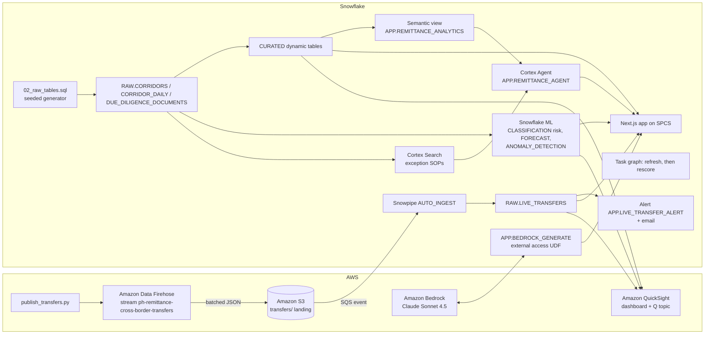

# Philippine Inbound Remittance Corridors - Exceptions and Payout Operations

End-to-end remittance operations for **40 inbound corridors of a fictional Philippine remittance operator, from 5 send markets** (Saudi Arabia, United Arab Emirates, United States, Hong Kong, Singapore) **into 5 Philippine payout cities** (Quezon City, Cebu City, Davao City, Iloilo City, Baguio City) using Snowflake, optionally with AWS: from a live transfer exception to a 7-day failed-transfer risk score, an alert email and an AI action memo for the remittance operations team.

## Architecture

A remittance-operations pipeline built on **Snowflake** (Dynamic Tables, Snowflake ML, Cortex Search, Cortex Agent, Cortex AI_COMPLETE, SPCS) and, in the full build, **AWS** (Amazon Data Firehose, S3, Bedrock Claude, QuickSight + Amazon Q). Transfer events land in `RAW.LIVE_TRANSFERS`. Dynamic tables curate 90 days of corridor-day history: transfers paid out, exceptions raised, failed transfers, payout SLA breaches, straight-through rate and payout-partner prefunding reconciliation compliance. Snowflake ML scores 7-day failed-transfer risk per corridor, forecasts operator-wide exception volume and flags screening hit rate anomalies. A Cortex Agent answers questions with SOP citations, and an LLM drafts the operations action memo.

Interactive diagrams (hover for object names): [Snowflake only](docs/architecture-snowflake.html) | [AWS + Snowflake](docs/architecture-aws.html). The app shows both on its Architecture & Data tab, the current build first. Regenerate them with `python3 docs/build_architecture.py aws` and `python3 docs/build_architecture.py snowflake`.



The Snowflake-only build drops the AWS subgraph: `APP.SIMULATE_TRANSFERS` writes to `RAW.LIVE_TRANSFERS`, and the app calls Cortex `AI_COMPLETE` instead of the Bedrock UDF.

## Snowflake Capabilities

| Capability | Implementation |
|-----------|---------------|
| Dynamic Tables | `CURATED.KPI_SUMMARY`, `PERFORMANCE_SUMMARY`, `EXCEPTION_SUMMARY`, `TREND_ANALYSIS` from the RAW tables |
| Snowflake ML | CLASSIFICATION 7-day transfer-failure risk (`ML.FAILURE_RISK_SCORES`), 14-day exception-volume FORECAST, screening hit rate ANOMALY_DETECTION |
| Cortex Search | 14 synthetic exception-handling SOPs (one per send market and exception type) in `SEARCH.EXCEPTION_SOP_SEARCH` |
| Semantic View | `APP.REMITTANCE_ANALYTICS` over corridors, exception types, daily totals and risk |
| Cortex Agent | `APP.REMITTANCE_AGENT`: Cortex Analyst over the semantic view plus Cortex Search for SOP citations |
| Cortex AI | `AI_COMPLETE('claude-sonnet-4-5')` for grounded answers, and for the action memo in the Snowflake-only build |
| Alerts + Tasks | `APP.LIVE_TRANSFER_ALERT` logs EXCEPTION events and sends email; task graph `TASK_REFRESH_CURATED`, then `TASK_RESCORE_RISK` |
| Snowpark Container Services | Next.js app `APP.PH_REMITTANCE_CROSS_BORDER_APP` with 6 tabs: Executive Cockpit, Predictive, Controls, Live Transfers, Ask AI, Architecture & Data |
| Snowpipe | `RAW.LIVE_TRANSFERS_PIPE` AUTO_INGEST from S3 (AWS build only) |

## AWS Services

Used only in the AWS + Snowflake build.

| Service | Role in Demo |
|---------|-------------|
| Amazon Data Firehose | Direct PUT stream `ph-remittance-cross-border-transfers` receives simulated remittance transfer events and writes batches to S3 |
| Amazon S3 | Landing bucket (`transfers/`). An event notification goes to the Snowpipe SQS queue |
| Amazon Bedrock | Claude Sonnet 4.5 writes the action memo, called from Snowflake through an external-access UDF |
| Amazon QuickSight | DIRECT_QUERY executive dashboard over Snowflake (daily exceptions, failed transfers by corridor, transfer-failure risk) |
| Amazon Q | Natural-language questions over the QuickSight topic `ph-remittance-cross-border-topic` |
| AWS IAM | Least-privilege roles for S3, Firehose and Bedrock |

## Personas

These personas are fictional.

| Persona | Role | Key Questions |
|---------|------|---------------|
| **Marisol Dizon** | Head of Remittance Operations | "What is our straight-through rate?" "Which exception types turn into failed transfers?" |
| **Paolo Villanueva** | Corridor Exceptions Analyst | "Which corridors are high risk this week, and which SOP applies?" |

## Data

All data is synthetic and seeded, so every rebuild reproduces it. The remittance operator, its payout partners, corridors and names are fictional; the cities and send markets are real places used as labels only.

| Table | Rows | Description |
|-------|------|-------------|
| RAW.CORRIDORS | 40 | Inbound remittance corridors from 5 send markets into 5 Philippine payout cities, with payout-partner risk tier and corridor age |
| RAW.CORRIDOR_DAILY | 3,600 | Daily corridor observations over 90 days: transfers, payout value (PHP), exceptions, failed transfers, payout SLA breaches, exception type, prefunding reconciliation, screening hit rate and time to payout |
| RAW.DUE_DILIGENCE_DOCUMENTS | 40 | Required, on-file and pending payout-partner due-diligence documents per corridor |
| SEARCH.EXCEPTION_DOCS | 14 | Synthetic exception-handling SOPs indexed for Cortex Search |
| RAW.LIVE_TRANSFERS | Grows during the demo | Live transfer events from Firehose (AWS build) or `APP.SIMULATE_TRANSFERS` (Snowflake-only build) |
| ML.FAILURE_RISK_SCORES | 40 | 7-day failed-transfer probability and risk band per corridor |

## Build Instructions

### Prerequisites
- Snowflake account with ACCOUNTADMIN access, and Cortex AI enabled (AI_COMPLETE, Search, Agent).
- An X-Small warehouse with auto-suspend at or below 120 s, and an existing SPCS compute pool.
- Python 3.11+, `snowflake-connector-python`, Node.js 22+, Docker and the `snow` CLI.
- App image: run `snow spcs image-registry login`, then build and push `ph-remittance-cross-border-app:v1` to the database's `APP.IMAGES` repository (see the header of `snowflake/07_deploy_app.sql`).
- AWS build only: `boto3`, AWS credentials for the target account (us-west-2) with Bedrock access, and QuickSight Enterprise.

### SPCS App
```
<DATABASE>.APP.PH_REMITTANCE_CROSS_BORDER_APP
```

### Tests
```bash
python -m pytest aws snowflake quicksight
```

For a local run, put `SNOWFLAKE_ACCOUNT`, `SNOWFLAKE_USER`, `SNOWFLAKE_DATABASE`, `SNOWFLAKE_WAREHOUSE`, `SNOWFLAKE_AUTHENTICATOR=PROGRAMMATIC_ACCESS_TOKEN`, `SNOWFLAKE_TOKEN` and `DEMO_PLATFORM` in the environment, then run `npm --prefix app run build && npm --prefix app start`.

## Build Modes

Both modes share the same core. They differ in three places, and the app's `DEMO_PLATFORM` setting (in its SPCS spec) switches the memo provider and the Live Transfers tab.

| Layer | Snowflake Only | Full AWS + Snowflake |
|---|---|---|
| Live transfers | `CALL APP.SIMULATE_TRANSFERS(n)` inserts simulated transfer events into `RAW.LIVE_TRANSFERS`. This simulates a transfer feed; it is not Snowpipe Streaming | `aws/publish_transfers.py` to Amazon Data Firehose, then S3, SQS and Snowpipe AUTO_INGEST |
| Action memo | Cortex `AI_COMPLETE('claude-sonnet-4-5')` | Amazon Bedrock Claude Sonnet 4.5 through `APP.BEDROCK_GENERATE` |
| BI and natural-language questions | The SPCS app is the dashboard; questions go to the Cortex Agent | Also a QuickSight dashboard and an Amazon Q topic |
| App setting | `DEMO_PLATFORM: snowflake` | `DEMO_PLATFORM: aws` |

### Snowflake Only

```bash
# 1. Core data and dynamic tables (guarded: new isolated database only)
python snowflake/run_core.py --database PHILIPPINES_REMITTANCE_CROSS_BORDER_SNOWFLAKE --warehouse <XS_WAREHOUSE> --connection <CONNECTION> --apply
# 2. Native transfer feed, ML, search, semantic view, agent, alert and task graph
python snowflake/run_intelligence.py --database PHILIPPINES_REMITTANCE_CROSS_BORDER_SNOWFLAKE --platform snowflake --warehouse <XS_WAREHOUSE> --connection <CONNECTION> --alert-email you@example.com
# 3. App on SPCS with DEMO_PLATFORM=snowflake (push the image first)
python snowflake/run_intelligence.py --database PHILIPPINES_REMITTANCE_CROSS_BORDER_SNOWFLAKE --platform snowflake --warehouse <XS_WAREHOUSE> --connection <CONNECTION> --alert-email you@example.com --files 07_deploy_app.sql --compute-pool <COMPUTE_POOL>
```

During the demo:
- Run `CALL APP.SIMULATE_TRANSFERS(20)` to add live transfer events. For a continuous feed, run `ALTER TASK APP.TASK_SIMULATE_TRANSFERS RESUME`, and `SUSPEND` it afterwards.
- Run `EXECUTE ALERT APP.LIVE_TRANSFER_ALERT` to raise the alert email.
- Run `EXECUTE TASK APP.TASK_REFRESH_CURATED` to refresh the curated tables and rescore risk.

Afterwards, drop the database or run `ALTER SERVICE APP.PH_REMITTANCE_CROSS_BORDER_APP SUSPEND`.

### Full AWS + Snowflake

```bash
# 1. Core data and dynamic tables (guarded: new isolated database only)
python snowflake/run_core.py --database PHILIPPINES_REMITTANCE_CROSS_BORDER_AWS --warehouse <XS_WAREHOUSE> --connection <CONNECTION> --apply
# 2. AWS ingestion and Bedrock (dry run first, then --apply)
python aws/setup_aws.py --database PHILIPPINES_REMITTANCE_CROSS_BORDER_AWS --account <AWS_ACCOUNT_ID> --connection <CONNECTION> --apply
# 3. ML, search, semantic view, agent, alert and task graph
python snowflake/run_intelligence.py --database PHILIPPINES_REMITTANCE_CROSS_BORDER_AWS --platform aws --warehouse <XS_WAREHOUSE> --connection <CONNECTION> --alert-email you@example.com
# 4. App on SPCS with DEMO_PLATFORM=aws (push the image first)
python snowflake/run_intelligence.py --database PHILIPPINES_REMITTANCE_CROSS_BORDER_AWS --platform aws --warehouse <XS_WAREHOUSE> --connection <CONNECTION> --alert-email you@example.com --files 07_deploy_app.sql --compute-pool <COMPUTE_POOL>
# 5. QuickSight dashboard and Q topic (needs an existing Snowflake data source)
python quicksight/build_dashboards.py --database PHILIPPINES_REMITTANCE_CROSS_BORDER_AWS --account <AWS_ACCOUNT_ID> --principal-arn <QUICKSIGHT_USER_ARN> --data-source-arn <DATA_SOURCE_ARN> --prefix ph-remittance-cross-border --apply --update --with-topic
```

QuickSight objects must be shared with the QuickSight user who signs in (`--principal-arn`); otherwise the console shows nothing.

During the demo:
- Run `python aws/publish_transfers.py --count 20` to send live transfer events. Firehose buffers for up to 60 seconds before writing to S3.
- Run `EXECUTE ALERT APP.LIVE_TRANSFER_ALERT` to raise the alert email.
- Run `EXECUTE TASK APP.TASK_REFRESH_CURATED` to refresh the curated tables and rescore risk.

Afterwards, `python aws/teardown_aws.py --database PHILIPPINES_REMITTANCE_CROSS_BORDER_AWS --account <AWS_ACCOUNT_ID> --connection <CONNECTION> --apply` removes the AWS resources and the account-level Bedrock external-access and S3 storage integrations. It leaves the email integration `PH_REMITTANCE_CROSS_BORDER_EMAIL_INT`, which the Snowflake-only build also uses.

## Business Impact

Industry research and Snowflake customer outcomes:
- **Speed target for remittances**: the G20 targets call for "75% of cross-border remittance payments in every corridor to provide availability of funds for the recipient within one hour of payment initiation and for the remainder of the market to be within one business day, by end-2027" -- [FSB, Targets for Addressing the Four Challenges of Cross-Border Payments: Final Report (2021)](https://www.fsb.org/uploads/P131021-2.pdf)
- **Remittance cost target**: the same report reaffirms the UN SDG for the "global average cost of sending $200 remittance to be no more than 3% by 2030, with no corridors with costs higher than 5%" -- [FSB, Targets for Addressing the Four Challenges of Cross-Border Payments: Final Report (2021)](https://www.fsb.org/uploads/P131021-2.pdf)
- **Western Union** (Snowflake customer), which helps people and businesses move money, "Reduces Costs 50% And Achieves Multi-Cloud Strategy With Snowflake" -- [Snowflake customer story: Western Union](https://www.snowflake.com/en/customers/all-customers/case-study/western-union/)

## Key Demo Numbers

These figures are synthetic and come from the seeded demo data. Forecast and anomaly figures can shift slightly with the build day.

- **40 corridors** from 5 send markets into 5 Philippine payout cities, 3,600 corridor-days over 90 days; **3,635,360 transfers** paid out, worth PHP 55,236 M
- **Straight-through rate 99.98%**: **755 exceptions** raised, of which **232** ended as failed transfers (exception failure rate 30.7%); **120 payout SLA breaches**
- **Beneficiary name mismatches** produce the most failed transfers (56 of 230 exceptions); the 16 payout network outage exceptions (Cebu City and Davao City) always clear without failure
- **Quezon City** corridors have the most failed transfers (93); Saudi Arabia is the largest send market (PHP 29,516 M)
- **Failed-transfer model** out-of-time holdout: precision 0.47, recall 0.35 at a 0.5 threshold, against a 0.26 base rate. 11 corridors are high risk; the top corridor is COR-0015, at 96.6%
- **14-day exception forecast** with prediction intervals; **39 of 640** corridor-days flagged as screening hit rate anomalies
- **Prefunding reconciliation compliance 73.1%**, payout-partner due-diligence document coverage 59.2%, with 20 documents pending
- **14 SOPs** indexed for Cortex Search and cited by ID in agent answers

## License

Apache 2.0 — See [LICENSE](LICENSE) for details.

This is a personal demo project and is not an official Snowflake offering. It comes with no support or warranty. Industry metrics cited are from publicly available third-party research and Snowflake customer stories; they represent reported outcomes and are not guarantees of results.
